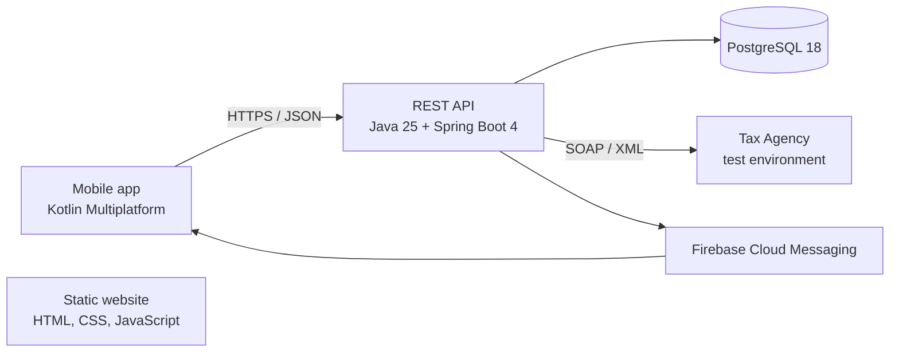

  

# Stocki

Stock, finances and sales management for small retail shops.

Final project (*Proyecto Intermodular*) of the Higher Vocational Degree in Cross-Platform Application Development (DAM), 2026/2027.

> **Project status: planning and analysis (iteration I0, 16 Nov – 13 Dec 2026).**
> The stack and features below are planned. Application development starts in iteration I1.

## The problem

Many small shops still track stock in notebooks and spreadsheets. Products run out without warning, purchases ignore the money available and accounts take hours to balance. From 1 July 2027, self-employed retailers who invoice with software must also comply with Verifactu, the Spanish verifiable invoicing regulation.

## Planned features

- **Inventory:** products created by barcode scan, configurable categories and units, movement history.
- **Low-stock alerts:** a minimum per product and push notifications.
- **Finances:** income, expenses and the money available for restocking.
- **Sales:** each scanned sale updates stock and income in a single transaction.
- **Verifactu:** chained invoicing records, QR code and submission to the Tax Agency test environment.
- **Export:** quarterly Excel and PDF reports for the accountant.
- **Roles:** administrator and employee.

## Planned architecture

| Area | Technologies |
|---|---|
| Mobile app | Kotlin Multiplatform, Compose Multiplatform, Ktor Client, ML Kit |
| Server | Java 25, Spring Boot 4, Spring Security, Spring Data JPA |
| Data | PostgreSQL 18, Flyway |
| Website | HTML, CSS, JavaScript |
| Testing | JUnit, Mockito, Testcontainers, JaCoCo, kotlin.test |
| DevOps | Docker, GitHub Actions, Azure for Students |

## Repository structure

| Folder | Content |
|---|---|
| [`app/`](app/README.md) | Mobile application |
| [`server/`](server/README.md) | REST API and database migrations |
| [`web/`](web/README.md) | Product website |
| [`docs/`](docs/README.md) | Roadmap, risks and meeting minutes |

## Team

| Member | Responsibilities |
|---|---|
| Marcos | Server, database, Tax Agency integration, deployment |
| Carlos | Cross-platform app, UI, scanner, notifications, website |

Analysis, testing and documentation are shared.

## Contributing

See [CONTRIBUTING.md](CONTRIBUTING.md) for the team workflow.
